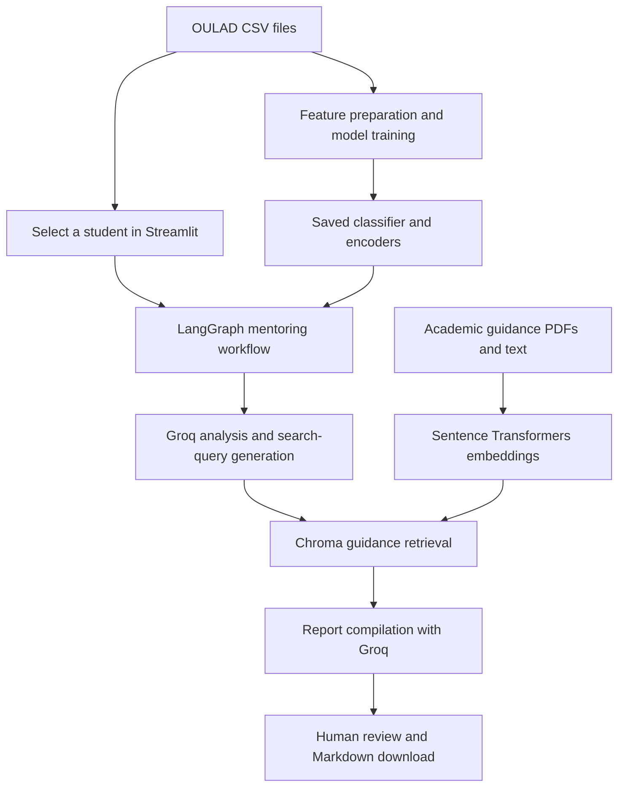

# 🎓 AI Academic Mentor

**Student outcome classification and AI-assisted mentoring · CSIT Data Science Hackathon 2025**

A Python prototype combining OULAD student records, a scikit-learn classifier, a LangGraph workflow, and retrieval of academic guidance to prepare mentoring reports in Streamlit.

[Hosted demo](https://ai-academic-mentor.streamlit.app/) · [Training notebook](3_Notebooks/01_OULAD_Exploration_and_Training.ipynb) · [Application source](9_Deployment/app.py)

## Why this project

Academic records and support resources often live in separate places. This project explores a workflow that brings them together: select a student, estimate an academic outcome, retrieve relevant guidance, and draft a report for a person to review.

**Status:** Hackathon prototype. The committed notebook records **64.8% held-out classification accuracy**. Prospective early-warning performance and the effectiveness of suggested interventions have not been established.

## What is implemented

| Component | Current behavior |
| --- | --- |
| **Outcome classifier** | A `GradientBoostingClassifier` predicts Distinction, Fail, Pass, or Withdrawn from six student and assessment features. |
| **Mentoring workflow** | A fixed LangGraph sequence loads student information, predicts an outcome, drafts an analysis, prepares a search query, retrieves guidance, and compiles a report. |
| **LLM integration** | Groq handles analysis, query generation, and report writing. The default is `openai/gpt-oss-20b`; `GROQ_MODEL` can select a model available to your account. |
| **Guidance retrieval** | Sentence Transformers embeddings and a persistent Chroma store retrieve academic guidance text. |
| **Interactive app** | Streamlit supports student selection, report generation, and Markdown report downloads. |
| **Batch orchestration** | A Prefect flow retrains the classifier, predicts outcomes, selects students predicted to Fail or Withdrawn, maps report generation over those students, and saves JSON results. |

Missing credentials, provider failures, failed predictions, and unavailable guidance stop the workflow with an explicit error. A download is offered only after the complete workflow returns a report.

## How it works



The batch entry point in [`5_Pipeline/prefect_flow.py`](5_Pipeline/prefect_flow.py) uses the same mentoring workflow and writes `7_Results/mentor_reports.json`. Running the flow is an explicit action; a recurring deployment schedule is not included.

## Recorded model results

The [training notebook](3_Notebooks/01_OULAD_Exploration_and_Training.ipynb) contains saved output for the following historical run. These are not new benchmark results or verified measurements of the hosted app.

| Evaluation detail | Recorded value |
| --- | --- |
| Model | `GradientBoostingClassifier` |
| Split | Stratified random 80% training / 20% test, `random_state=42` |
| Training records | 26,074 |
| Test records | 6,519 |
| Overall test accuracy | **64.80%** |
| Macro F1 | **0.58** |

| Outcome | Precision | Recall | F1 | Test support |
| --- | ---: | ---: | ---: | ---: |
| Distinction | 0.62 | 0.46 | 0.53 | 605 |
| Fail | 0.49 | 0.29 | 0.36 | 1,411 |
| Pass | 0.67 | 0.87 | 0.75 | 2,472 |
| Withdrawn | 0.69 | 0.69 | 0.69 | 2,031 |

The six model inputs are `gender`, `disability`, `num_of_prev_attempts`, `studied_credits`, `avg_score`, and `num_assessments`. See [`ModelTraining.train_model()`](4_Src_Code/model_training.py) for preparation and training.

Assessment features aggregate the available records by student ID without a prediction-time cutoff. This random split does not establish performance on future cohorts or early in a course. The recorded **29% recall for Fail** means many Fail outcomes were missed in this test. A combined Fail/Withdrawn precision score and throughput benchmarks are not reported here.

## Run locally

### 1. Clone and install

Python 3.11 is a recommended starting point. scikit-learn is pinned to **1.6.1**, the version recorded in the committed classifier and encoders. Other dependencies use lower bounds rather than a fully locked environment.

```bash
git clone https://github.com/KhuzaimaHassan/AI-Academic-Mentor.git
cd AI-Academic-Mentor
python -m venv .venv
```

Activate the environment:

```powershell
# Windows PowerShell
.\.venv\Scripts\Activate.ps1
```

```bash
# macOS / Linux
source .venv/bin/activate
```

```bash
python -m pip install -r requirements.txt
```

The first use of the embedding model may download its weights.

### 2. Configure Groq

Set the environment variable in the terminal that will launch Streamlit or Prefect:

```powershell
# Windows PowerShell
$env:GROQ_API_KEY = "your_groq_api_key_here"
```

```bash
# macOS / Linux
export GROQ_API_KEY="your_groq_api_key_here"
```

Alternatively, create `.streamlit/secrets.toml`, or enter these settings in Streamlit Cloud's secrets editor:

```toml
[groq]
GROQ_API_KEY = "your_groq_api_key_here"
GROQ_MODEL = "openai/gpt-oss-20b"
```

The agent checks a constructor-supplied key first, then Streamlit secrets, the legacy root `config.py` setting, and finally the environment variable. Prefer secrets or an environment variable to editing tracked configuration. Creating a `.env` file alone does not ensure the agent entry point loads it.

Model selection checks a constructor override, `[groq].GROQ_MODEL` in Streamlit secrets, then the `GROQ_MODEL` environment variable, and finally the default. Model availability depends on the account; verify access in Groq before selecting a different model. This configuration does not change the provider plan or billing settings.

### 3. Check the data and model files

Run commands from the **repository root** so relative paths resolve correctly.

- OULAD CSVs are included under `Data_csv's/`. The current training method reads `studentInfo.csv`, `studentAssessment.csv`, and `assessments.csv`.
- The large `studentVle.csv` is excluded and is not required by the current six-feature training method or mentoring path. Download it from the [OULAD dataset page](https://analyse.kmi.open.ac.uk/open_dataset) for analyses that use VLE activity.
- Saved classifier/encoder files and a Chroma store are included under `6_Models/`. Regenerate them if their serialized formats are incompatible with your installed libraries.

To rebuild the classifier and encoders from the repository root:

```bash
python -c "import sys; sys.path.insert(0, '4_Src_Code'); from model_training import ModelTraining; ModelTraining().train_model()"
```

This overwrites `trained_model.pkl`, `final_result_encoder.pkl`, `feature_encoders.pkl`, and `feature_columns.pkl` in `6_Models/` and prints evaluation results.

For notebook exploration instead:

```bash
python -m pip install jupyterlab
python -m jupyterlab
```

Open `3_Notebooks/01_OULAD_Exploration_and_Training.ipynb`. It uses paths relative to its directory; do not run the `.ipynb` file with `python`.

### 4. Rebuild guidance retrieval if needed

The builder accepts PDFs and text files in `1_Documentation/RAG_Knowledge_Base/`. The repository contains a sample academic-success guide.

```bash
python build_vectorstore.py
```

This **replaces `6_Models/vectorstore/`**. Review the knowledge-base contents before rebuilding. The bundled guide is demonstration material, not a validated intervention evidence base.

### 5. Launch the app

```bash
streamlit run 9_Deployment/app.py
```

Open the local URL printed by Streamlit, select a student ID, and generate a report. Review the prediction, generated analysis, and retrieved guidance before using it.

### Optional: run the batch flow

```bash
python 5_Pipeline/prefect_flow.py
```

The flow retrains the model before processing the student list. It can generate many Groq requests and writes results to `7_Results/mentor_reports.json`; start with the interactive app when exploring the project.

## Repository guide

| Path | Purpose |
| --- | --- |
| [`3_Notebooks/`](3_Notebooks/) | Exploration, training, and saved evaluation output |
| [`4_Src_Code/model_training.py`](4_Src_Code/model_training.py) | Feature preparation, classifier training, and artifact persistence |
| [`4_Src_Code/utils/helpers.py`](4_Src_Code/utils/helpers.py) | Student feature lookup and predictions from saved artifacts |
| [`4_Src_Code/agentic_ai_pipeline.py`](4_Src_Code/agentic_ai_pipeline.py) | LangGraph workflow and Groq calls |
| [`4_Src_Code/rag_integration.py`](4_Src_Code/rag_integration.py) | Embeddings, Chroma retrieval, and guidance formatting |
| [`5_Pipeline/prefect_flow.py`](5_Pipeline/prefect_flow.py) | Batch orchestration and JSON report output |
| [`6_Models/`](6_Models/) | Classifier, encoders, and vector store |
| [`9_Deployment/app.py`](9_Deployment/app.py) | Streamlit interface and Markdown download |
| [`Data_csv's/`](Data_csv's/) | Included OULAD tables |
| [`build_vectorstore.py`](build_vectorstore.py) | Knowledge-base index rebuild |

**Stack:** Python, pandas, scikit-learn, Joblib, LangGraph, Groq, LangChain, Sentence Transformers, Chroma, Prefect, Streamlit, and Plotly.

## Limitations and next steps

- **Prediction scope:** Define a course-relative prediction cutoff and evaluate on held-out cohorts before making early-warning claims. Review aggregation by student ID for students appearing in multiple modules or presentations.
- **Generated explanations:** LLM “root cause” text is a hypothesis, not a causal finding. Demographic features and prompts need fairness and subgroup evaluation before practical use.
- **Guidance quality:** Intervention effectiveness and comprehensive citation accuracy have not been established. Human review remains part of the workflow.
- **Reproducibility:** Keep the pinned scikit-learn version when loading the committed classifier. Provider model availability and Chroma/LangChain version compatibility can also affect fresh installations.
- **Scale and operations:** Mapped Prefect tasks are implemented, but report latency, full-cohort throughput, recovery behavior, and a recurring production schedule are not established by the classifier evaluation.

## Regression checks

Run from the repository root after installing the requirements:

```bash
python -m unittest discover -s tests -v
```

The tests use controlled provider and retrieval fixtures. They cover workflow success, model-access failures, rate limits, missing credentials, empty responses, failed predictions/retrieval, and whether the interface offers a download. They do not certify live provider access; a hosted report check is still required.

## Team and acknowledgments

Built for the **CSIT Data Science Hackathon 2025** by **Ebaad Khan, Ezaan Khan, Syed Ahmed Ali, and Khuzaima Hassan**.

The project uses the **Open University Learning Analytics Dataset (OULAD)**. See the [official dataset page](https://analyse.kmi.open.ac.uk/open_dataset) for provenance, documentation, and data terms.

## License

Developed for the CSIT Data Science Hackathon 2025. **All rights reserved.** No standalone project license file is currently included.
