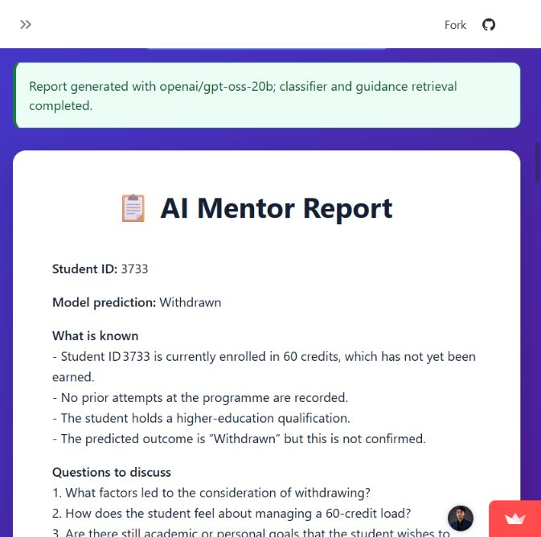

# Hosted app check — November 2, 2026

**Target:** [AI Academic Mentor](https://ai-academic-mentor.streamlit.app/)

**Repaired deployment source:** `f28244c437348f31d5c609ab116d28b91c2e6683`

**Latest outcome:** After repair #11, a fresh hosted report completed for example 3733 with prediction Withdrawn and both guidance excerpts. Source text rendered without the earlier `[object Object]` corruption. Eleven overlapping native-size captures cover this report through its disclaimer and download control. Earlier download verification remains recorded separately below. The exact cause of the preceding hosted retrieval failure was not observable from the public UI; the repaired deployment uses the locally tested Chroma runtime and an absolute index path.

## Final checks after repair

| Check | Outcome | Evidence and limits |
| --- | --- | --- |
| Dashboard and student selector | Passed | The dashboard loaded and selecting 6516 updated the profile. The recorded profile outcome is distinct from a new classifier prediction. |
| Hosted mentoring workflow | Passed for example 3733 | The public app reported completion with `openai/gpt-oss-20b`, the classifier, and guidance retrieval. The report displayed student ID 3733 and model prediction Withdrawn. |
| Guidance provenance | Passed for this report | Two excerpts from `academic_success_guide.txt` appeared under Retrieved guidance. They are demonstration guidance, not an independently validated intervention evidence base. |
| Markdown report download | Earlier file check passed; latest file transfer unverified | Previously downloaded `mentor_report_3733.md` and inspected its 4,372 characters for the student ID, prediction and sources. The newest run displayed its download control, but the browser automation timed out waiting for a new download event; no fresh file transfer is claimed. |
| Workflow and UI regression suite | Passed | All 16 tests passed, including missing/empty guidance stores, working-directory independence, actionable index errors, report rendering, failure paths and committed classifier inference. Provider calls in automated tests use fixtures. |
| Real local guidance query | Passed | A temporary copy of the committed index retrieved both real excerpts (1,921 characters) using the pinned Chroma runtime and cached embedding model. The committed index was not rebuilt or changed. |
| Real local classifier check | Passed | The committed artifacts loaded with scikit-learn 1.6.1 and predicted Withdrawn for 3733 and Pass for 6516. No model was retrained. |
| UI contrast recheck | Passed for inspected surfaces | After repairs #7–#8, the hosted dashboard totals fit on one line in the current narrow view, profile selection updated to 6516, and another report completed for 3733. Computed styles confirmed a solid pale-green success alert with dark-green text and dark headings on white report cards. The refreshed screenshots show these surfaces. |
| Output accuracy and intervention effectiveness | Not certified | Generated advice still needs human review. This sample test does not establish causal validity, perfect factuality, fairness, throughput, or effectiveness. |
| Continuous availability | Not guaranteed | The visit woke the app. No periodic keep-alive monitor, billing change, or uptime guarantee was configured. |

The [complete capture sequence in the README](../README.md#generated-mentoring-report) replaces the blurry enlarged image. Its overlapping frames are raw native-size browser screenshots, not resized images or saved-report recreations. The report still assumes credits have not been earned and presupposes withdrawal consideration; those claims are not established by the supplied profile. Generated advice remains a draft for review.

The [earlier enlarged capture](images/04-successful-mentor-report.jpg) is retained only as historical evidence. It predates source-display repair #9 and preserves its old rendering defect. The latest report confirms that the repaired source renderer also executes successfully on the hosted app.

## Initial checks before repair

| Check | Outcome | Evidence and limits |
| --- | --- | --- |
| Recover from sleep | Passed | Clicked Streamlit's “Yes, get this app back up!” button. After startup, the actual application replaced the sleep/loading screen. |
| Render dashboard | Passed | Dataset summary cards showed 32,593 records, 37.9% Pass rate, 80 average credits, and 7 courses. These are UI observations, not an independent data audit. |
| Load default profile | Passed | The app displayed OULAD example student 3733 and its recorded Withdrawn outcome. |
| Change selected student | Passed | Selected 6516. The profile updated to ID 6516, Scotland, module AAA, presentation 2014J, and recorded outcome Pass. |
| Generate mentoring report | Failed | For student 3733, the final report card contained a Groq `404 model_not_found` error for `llama-3.1-8b-instant`. No successful mentor report was produced. |
| Offer report download | Failure handling issue | A Download Report button was displayed even though the report content was an error. A successful report download was not verified. |
| End-to-end classifier and retrieval | Not established | Sidebar badges alone are insufficient evidence. No successful complete mentoring run was available to certify the internal stages. |
| Remaining awake after inactivity | Not guaranteed | The visit woke the app for this session. No periodic monitor or hosting-plan change was configured. |

## Dashboard and profile

The profile's result is an existing dataset value. It is separate from a prediction produced by the report workflow.

## Initial report-generation failure — resolved

The initial provider response stated that the configured model did not exist or that the account did not have access. This did **not** prove the API key was missing or that the model had been universally retired.

[Groq's model documentation](https://console.groq.com/docs/models), checked on the same date, listed `llama-3.1-8b-instant` as an Enterprise entry. The repaired deployment successfully used `openai/gpt-oss-20b`. No provider key, plan, or billing setting was changed.

## How to check the repaired workflow

1. Open the hosted app and wake it if Streamlit shows its sleep page.
2. Leave the default student ID at 3733.
3. Click **Generate AI Mentor Report** and wait for the workflow to finish.
4. Confirm the success message and the report's explicit student ID, model prediction, and Retrieved guidance section. An error must not appear as a downloadable report.
5. Download the Markdown report and compare it with the displayed prediction and source excerpts. Downloading can rerun Streamlit and clear the on-screen report; the file should still contain the generated report.
6. Select another ID such as 6516 and verify that the displayed profile updates.

## Repairs deployed

- The model is configurable, with `openai/gpt-oss-20b` as the default. Provider rejection, missing credentials, failed prediction/retrieval, and empty responses stop the workflow explicitly. Downloads are offered only for completed reports. See [repair #3](https://github.com/KhuzaimaHassan/AI-Academic-Mentor/pull/3).
- The committed classifier/encoders record scikit-learn **1.6.1**. Pinning that runtime restored hosted prediction; the same artifacts passed local inference checks. See [compatibility repair #4](https://github.com/KhuzaimaHassan/AI-Academic-Mentor/pull/4).
- Generated reports include the actual prediction and retrieved excerpts. Prompts distinguish facts from open questions and prohibit invented contacts, dates, and personal circumstances. Markdown tables render as tables. These constraints reduce observed problems but do not certify every generated claim. See [report presentation repair #5](https://github.com/KhuzaimaHassan/AI-Academic-Mentor/pull/5).
- A clean dependency rebuild was requested after the page picked up new rendering while an older workflow module remained in memory. The final live report included the new deterministic evidence section, confirming that the updated workflow executed. See [runtime update #6](https://github.com/KhuzaimaHassan/AI-Academic-Mentor/pull/6).
- Text colors now follow their surface: light text on the deeper purple background, dark text and headings on white cards, and solid alert backgrounds with readable status text. Button, dropdown, table, and status colors were also adjusted. Both existing UI tests passed; selected text/background pairs exceed 4.5:1 contrast. This is not a complete accessibility audit. See [UI contrast repair #7](https://github.com/KhuzaimaHassan/AI-Academic-Mentor/pull/7).
- The expanded report capture exposed corrupted source-excerpt lines rendered as `[object Object]`. Escaped multiline excerpts now use a plain pre-wrapped block instead of Streamlit's nested code-widget renderer. Both UI tests passed, including an indented multiline-source and HTML-escaping regression. See [source display repair #9](https://github.com/KhuzaimaHassan/AI-Academic-Mentor/pull/9).
- The later hosted retrieval failure was followed by a successful local query of the committed index. Deployment now pins ChromaDB 1.2.0 and langchain-chroma 1.0.0, resolves the default index path from the repository, and rejects missing/empty stores rather than implicitly creating an empty collection. All 16 regressions and the real local query passed; a fresh hosted report then completed. See [retrieval repair #11](https://github.com/KhuzaimaHassan/AI-Academic-Mentor/pull/11).

The sidebar now reports the configured model and explains when workflow checks occur; its old unconditional health badges were removed.

Screenshots are genuine captures of the public OULAD demo. The dashboard uses the earlier narrow view and the profile uses the requested wider layout. The latest report uses eleven overlapping native-size frames because enlarging a single browser capture softened the text. Summary-card spacing also keeps dashboard totals on one line in narrow views; see [layout repair #8](https://github.com/KhuzaimaHassan/AI-Academic-Mentor/pull/8). Historical error and enlarged report images are identified separately. No private student records, provider credentials, or account-management screens were captured. No model training, vector-store rebuild, batch run, or credential change was performed.
