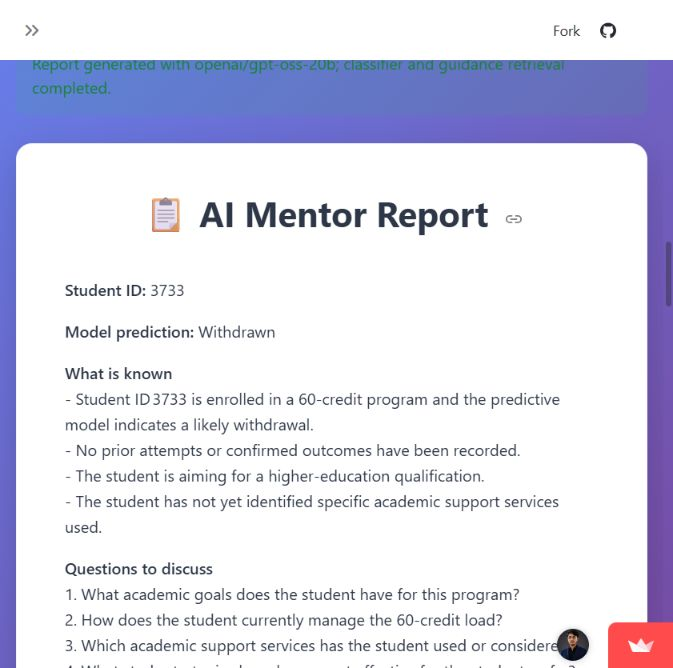

# Hosted app check — November 2, 2026

**Target:** [AI Academic Mentor](https://ai-academic-mentor.streamlit.app/)

**Repaired deployment source:** `4c1ccbd7f57dba158d2680fdb9bce6e40d1caf08`

**Final outcome:** The app woke successfully. Dashboard/profile interaction, a complete mentoring report, and its Markdown download passed the sample check after repair. The initial failures are preserved below as historical evidence.

## Final checks after repair

| Check | Outcome | Evidence and limits |
| --- | --- | --- |
| Dashboard and student selector | Passed | The dashboard loaded and selecting 6516 updated the profile. The recorded profile outcome is distinct from a new classifier prediction. |
| Hosted mentoring workflow | Passed for example 3733 | The public app reported completion with `openai/gpt-oss-20b`, the classifier, and guidance retrieval. The report displayed student ID 3733 and model prediction Withdrawn. |
| Guidance provenance | Passed for this report | Two excerpts from `academic_success_guide.txt` appeared under Retrieved guidance. They are demonstration guidance, not an independently validated intervention evidence base. |
| Markdown report download | Passed | Downloaded `mentor_report_3733.md`; inspected the 4,372-character file and confirmed the student ID, classifier prediction, two source labels, and absence of the earlier compilation-error text. |
| Workflow and UI regression suite | Passed | All 11 tests passed, including failure paths, empty responses, UI download visibility, table rendering, and inference from committed classifier artifacts. Provider calls in automated tests use fixtures. |
| Real local classifier check | Passed | The committed artifacts loaded with scikit-learn 1.6.1 and predicted Withdrawn for 3733 and Pass for 6516. No model was retrained. |
| Output accuracy and intervention effectiveness | Not certified | Generated advice still needs human review. This sample test does not establish causal validity, perfect factuality, fairness, throughput, or effectiveness. |
| Continuous availability | Not guaranteed | The visit woke the app. No periodic keep-alive monitor, billing change, or uptime guarantee was configured. |

## Initial checks before repair

| Check | Outcome | Evidence and limits |
| --- | --- | --- |
| Recover from sleep | Passed | Clicked Streamlit's “Yes, get this app back up!” button. After startup, the actual application replaced the sleep/loading screen. |
| Render dashboard | Passed | Dataset summary cards showed 32,593 records, 37.9% Pass rate, 80 average credits, and 7 courses. These are UI observations, not an independent data audit. |
| Load default profile | Passed | The app displayed OULAD example student 3733 and its recorded Withdrawn outcome. |
| Change selected student | Passed | Selected 6516. The profile updated to ID 6516, Scotland, module AAA, presentation 2014J, and recorded outcome Pass. |
| Generate mentoring report | Failed | For student 3733, the final report card contained a Groq `404 model_not_found` error for `llama-3.1-8b-instant`. No successful mentor report was produced. |
| Offer report download | Failure handling issue | A Download Report button was displayed even though the report content was an error. A successful report download was not verified. |
| End-to-end classifier and retrieval | Not established | Sidebar badges alone are insufficient evidence. No successful complete mentoring run was available to certify the internal stages. |
| Remaining awake after inactivity | Not guaranteed | The visit woke the app for this session. No periodic monitor or hosting-plan change was configured. |

## Dashboard and profile

The profile's result is an existing dataset value. It is separate from a prediction produced by the report workflow.

## Initial report-generation failure — resolved

The initial provider response stated that the configured model did not exist or that the account did not have access. This did **not** prove the API key was missing or that the model had been universally retired.

[Groq's model documentation](https://console.groq.com/docs/models), checked on the same date, listed `llama-3.1-8b-instant` as an Enterprise entry. The repaired deployment successfully used `openai/gpt-oss-20b`. No provider key, plan, or billing setting was changed.

## How to check the repaired workflow

1. Open the hosted app and wake it if Streamlit shows its sleep page.
2. Leave the default student ID at 3733.
3. Click **Generate AI Mentor Report** and wait for the workflow to finish.
4. Confirm the success message and the report's explicit student ID, model prediction, and Retrieved guidance section. An error must not appear as a downloadable report.
5. Download the Markdown report and compare it with the displayed prediction and source excerpts. Downloading can rerun Streamlit and clear the on-screen report; the file should still contain the generated report.
6. Select another ID such as 6516 and verify that the displayed profile updates.

## Repairs deployed

- The model is configurable, with `openai/gpt-oss-20b` as the default. Provider rejection, missing credentials, failed prediction/retrieval, and empty responses stop the workflow explicitly. Downloads are offered only for completed reports. See [repair #3](https://github.com/KhuzaimaHassan/AI-Academic-Mentor/pull/3).
- The committed classifier/encoders record scikit-learn **1.6.1**. Pinning that runtime restored hosted prediction; the same artifacts passed local inference checks. See [compatibility repair #4](https://github.com/KhuzaimaHassan/AI-Academic-Mentor/pull/4).
- Generated reports include the actual prediction and retrieved excerpts. Prompts distinguish facts from open questions and prohibit invented contacts, dates, and personal circumstances. Markdown tables render as tables. These constraints reduce observed problems but do not certify every generated claim. See [report presentation repair #5](https://github.com/KhuzaimaHassan/AI-Academic-Mentor/pull/5).
- A clean dependency rebuild was requested after the page picked up new rendering while an older workflow module remained in memory. The final live report included the new deterministic evidence section, confirming that the updated workflow executed. See [runtime update #6](https://github.com/KhuzaimaHassan/AI-Academic-Mentor/pull/6).

The sidebar now reports the configured model and explains when workflow checks occur; its old unconditional health badges were removed.

Screenshots are genuine captures of the public OULAD demo. Dashboard/profile images and the error image document the initial check; the successful report image documents the repaired workflow. No private student records, provider credentials, or account-management screens were captured. No model training, vector-store rebuild, batch run, or credential change was performed.
