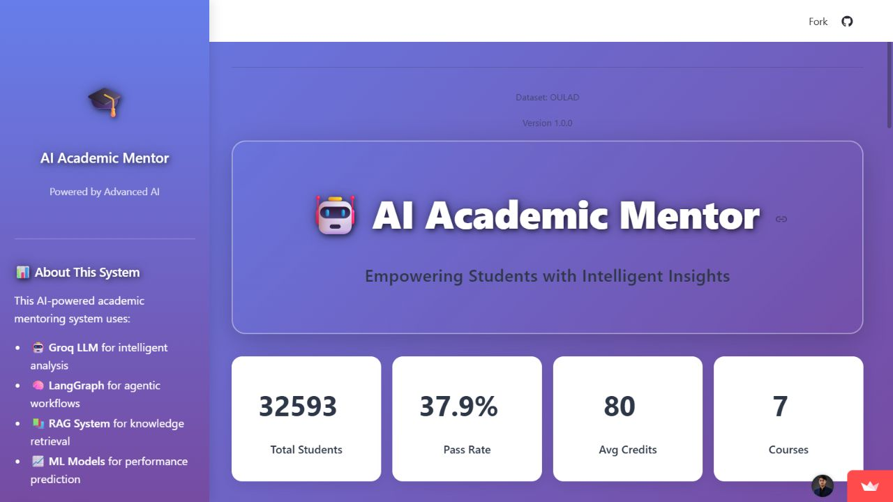
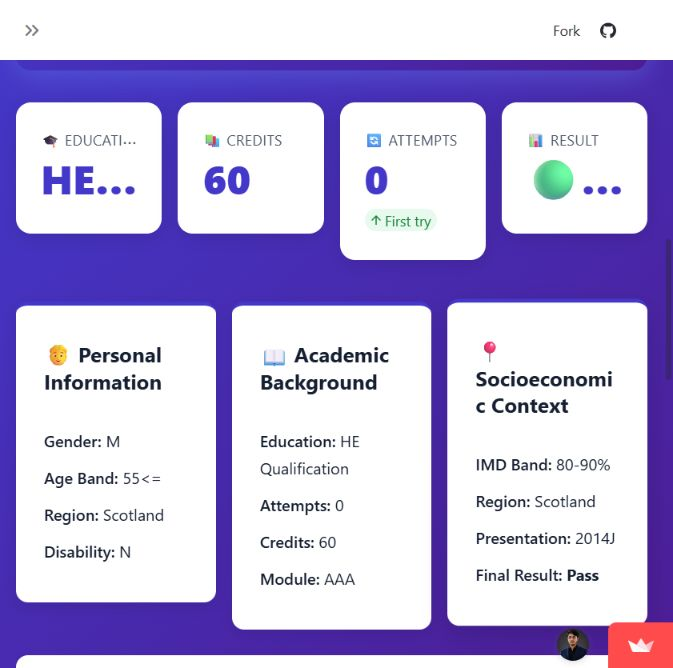
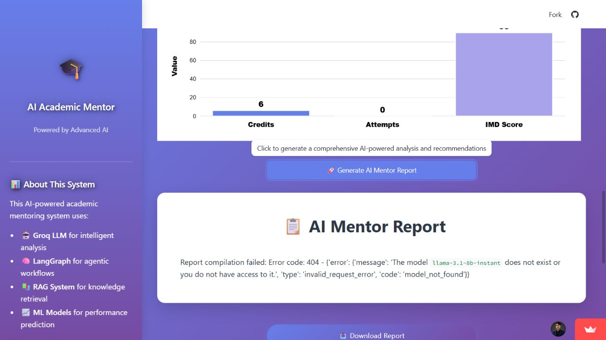

# Hosted app check — November 2, 2026

**Target:** [AI Academic Mentor](https://ai-academic-mentor.streamlit.app/)

**Source reviewed:** `e8bb4aaa40a3a8b3699c0165721c1ea987d30da6`

**Overall outcome:** Woke successfully; dashboard and profile interaction passed; mentor-report generation failed.

## Observed checks

| Check | Outcome | Evidence and limits |
| --- | --- | --- |
| Recover from sleep | Passed | Clicked Streamlit's “Yes, get this app back up!” button. After startup, the actual application replaced the sleep/loading screen. |
| Render dashboard | Passed | Dataset summary cards showed 32,593 records, 37.9% Pass rate, 80 average credits, and 7 courses. These are UI observations, not an independent data audit. |
| Load default profile | Passed | The app displayed OULAD example student 3733 and its recorded Withdrawn outcome. |
| Change selected student | Passed | Selected 6516. The profile updated to ID 6516, Scotland, module AAA, presentation 2014J, and recorded outcome Pass. |
| Generate mentoring report | Failed | For student 3733, the final report card contained a Groq `404 model_not_found` error for `llama-3.1-8b-instant`. No successful mentor report was produced. |
| Offer report download | Failure handling issue | A Download Report button was displayed even though the report content was an error. A successful report download was not verified. |
| End-to-end classifier and retrieval | Not established | Sidebar badges alone are insufficient evidence. No successful complete mentoring run was available to certify the internal stages. |
| Remaining awake after inactivity | Not guaranteed | The visit woke the app for this session. No periodic monitor or hosting-plan change was configured. |

## Dashboard and profile

The profile's result is an existing dataset value. It is separate from a prediction produced by the report workflow.

## Report-generation failure

The provider response stated that the configured model does not exist or that the account does not have access. This does **not** prove the API key is missing, that the model has been universally retired, or that switching model names will succeed for the same account.

[Groq's model documentation](https://console.groq.com/docs/models), checked on the same date, still lists `llama-3.1-8b-instant` as an Enterprise entry. The next step is to check the deployment account's available models and permissions, then choose an accessible model explicitly. No provider plan, key, billing setting, or model was changed during this check.

## How to reproduce

1. Open the hosted app and wake it if Streamlit shows its sleep page.
2. Leave the default student ID at 3733.
3. Click **Generate AI Mentor Report** and wait for the workflow to finish.
4. Check whether the result is an actual mentoring report or a provider error. In this check, the final content began with `Report compilation failed: Error code: 404`.
5. Select another ID such as 6516 and verify that the displayed profile updates.

## Source findings and proposed repair

- [`AgenticAIPipeline`](../4_Src_Code/agentic_ai_pipeline.py) hardcodes the Groq model. Allowing an explicit model setting would make future provider-access changes easier to handle.
- Pipeline stages turn exceptions into strings. `run_student_analysis()` can therefore return an error message as if it were report content.
- [`app.py`](../9_Deployment/app.py) renders the returned string and exposes it through Download Report without checking whether report generation succeeded.
- The sidebar's “AI Model: Active,” “RAG System: Ready,” and “ML Pipeline: Loaded” badges are unconditional labels, rather than results of live health checks.

A repair should use an account-accessible model, propagate stage failures explicitly, show an error state without a report download, and validate a real report with its prediction and retrieved guidance before capturing a success screenshot. These implementation changes are separate from this screenshots/documentation update.

Screenshots are genuine captures of the public OULAD demo. No private student records, provider credentials, or account-management screens were captured. No model training, vector-store rebuild, batch run, or credential change was performed.
